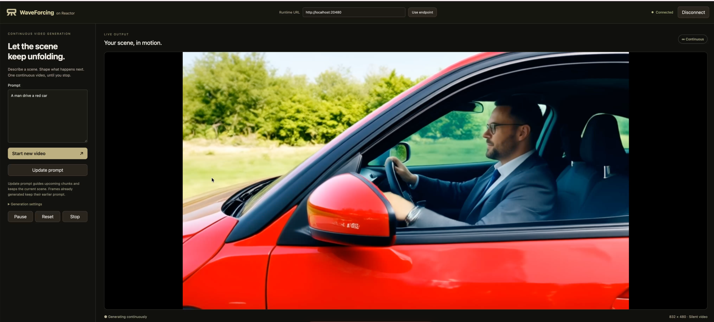

# WaveForcing on Reactor

Run [WaveForcing-1.3B](https://github.com/SJTU-DENG-Lab/WaveForcing) as a
continuous text-to-video service with [Reactor](https://reactor.inc). Describe a
scene, press **Start video**, and edit the prompt while video keeps streaming.
The small browser client follows the SGF+ demo's prompt-and-video layout.



The integration serves the released **4-step BF16 EMA** checkpoint on one GPU.
It supports live prompt changes, pause/resume, fresh-video reset and Stop.
Generation has no configured frame limit; it retains the native rolling visual
context and causal decoder state. Playback adapts to measured generation speed.

## What you need

- Linux, Docker, an NVIDIA driver and the
  [NVIDIA Container Toolkit](https://docs.nvidia.com/datacenter/cloud-native/container-toolkit/latest/install-guide.html).
- One NVIDIA B200 for the tested recipe. Other GPU types and low-memory/offload
  configurations have not been validated.
- About 15 GB of persistent storage for model assets, plus space for the image
  and build cache. Use a large volume for Docker storage and the weights cache.
- Node.js 22.12+ and npm for the frontend.

## 1. Install the CLI

```sh
brew install reactor-team/tools/reactor-cli
# Alternatively, use the official installer:
curl -fsSL https://reactor.inc/install | bash
reactor version
```

See the [CLI installation guide](https://docs.reactor.inc/deploy/platform/installation).
Run the remaining backend commands from this directory.

## 2. Build and start the model

```sh
reactor validate
reactor build
reactor run --gpus device=0 --port 8080 --shm-size 1g
```

Select a free GPU on a shared machine. `device=0` selects host GPU 0; the worker
sees it as its own device 0. First startup downloads the pinned 4-step EMA, Wan
text encoder, tokenizer and VAE automatically. It loads weights and warms up
before reporting ready; subsequent starts reuse the weights cache. The base
teacher DiT and training assets are not downloaded.

The default weights directory is `~/.cache/reactor_registry/waveforcing`.
To place weights on another volume, change `runtime.weights_path` in
`reactor.yaml` before starting. A completely prepared cache can be mounted
read-only; generation writes no session files into it.

**Check**, in another terminal:

```sh
curl -s http://localhost:8080/health
curl -s http://localhost:8080/schema
```

Wait for `"state":"available"`. Download and initialization time are excluded
from generation throughput. Rebuild after adapter, dependency or manifest
changes. `Ctrl+C` stops the service and releases GPU memory. A model inference
failure ends the service; restart the backend to continue after such an error.

## 3. Open the client

In a second terminal, from this directory:

```sh
cd demo
npm ci
npm run dev -- --host 127.0.0.1 --port 5173
```

Open [http://localhost:5173](http://localhost:5173). Set **Runtime URL** to
`http://localhost:8080`, click **Use endpoint**, then **Connect**. Enter a
prompt and press **Start video**. Connecting alone starts no generation. Applying a different Runtime URL ends
the current session before switching; applying the same URL keeps it.
This release uses text input; no reference image, camera or action controls
are exposed by this inference path.

**Check:** the video appears at 832×480 and the chunk/frame counts increase.
Video is silent. For a production frontend build:

```sh
npm run build
npm run preview -- --host 127.0.0.1 --port 5173
```

The included client connects to a local Runtime. Hosted use requires deployment,
an `owner/name` model identifier and a backend token exchange; a hosted endpoint
is not configured by this demo.

### A remote GPU machine

The browser must reach both HTTP and WebRTC media. An SSH forward of port 8080
alone does not carry WebRTC UDP. For SSH-only access, configure an authenticated
TURN/TCP relay through Runtime's `TURN_SERVERS` setting and forward that relay's
TCP listener too. Keep credentials outside this repository. Its relay address
must be reachable from the Runtime peer; a stopped Docker bridge is unsuitable.

For example, with a relay listening on GPU-host TCP port 3478:

```sh
ssh -N -L 8080:127.0.0.1:8080 -L 3478:127.0.0.1:3478 your-gpu-host
```

Run the frontend on the browser machine, or additionally forward its 5173 port
if it runs remotely. Use `http://localhost:8080` in the page and confirm a relay
candidate pair carries decoded video. See Runtime's
[networking configuration](https://github.com/reactor-team/reactor-runtime).

## Controls

| UI | SDK command | Behavior |
| --- | --- | --- |
| Start video / Start new video | `start(prompt, seed)` | Start a fresh video, replacing buffered playback. Seed defaults to 0. |
| Update prompt | `set_prompt(prompt)` | Guide future output while retaining visual history, random state and the current video. |
| Pause / Resume | `set_paused(paused)` | Stop/resume generation between chunks. Already buffered frames may still play. |
| Reset | `reset(seed?)` | Restart with the accepted prompt; keep the current seed unless a new one is supplied. |
| Stop | `stop()` | End the current video, clear playback and keep the prompt for another Start. |
| Connect / Disconnect | SDK session controls | Connect without generating; Disconnect ends the session. Reconnecting starts idle. |
| Client status synchronization | `get_state()` | Read the current snapshot without changing generation or notifying other viewers. |

A prompt update affects the next denoising tick. Some of the mixed-noise frontier
was already denoised with the previous prompt, and buffered video also keeps its
previous content. Changes can therefore take several chunks to become visible.
Updates while paused remain paused. Text conditioning guides generation;
precise scripted events and indefinite visual consistency are not guaranteed.

Every accepted state-changing command returns `state_update` and broadcasts the
complete current snapshot. Command refusals use the SDK's error path and do not
change the video. Joining clients read current state without restarting or
resuming a paused video. The schema at `/schema` describes arguments, error
codes, status fields and `main_video`.

## Continuous generation and validation

Video arrives at 832×480: nine frames in the first chunk, then twelve per
continuation. Model weights load once and remain on the GPU. The four-step
sampler, precision and rolling visual context follow the released reference.
Generation continues until paused, stopped or disconnected, without a configured
frame cap or a scene reset at a continuation boundary.

On one B200, one video reached **370 consecutive chunks / 4,437 frames**.
Steady generated-frame delivery measured **26.50 FPS** over chunks 30–370
(4,080 frames in 153.975 s). After service warmup, first-chunk compute took
0.74 s and its browser UI acknowledgment took 0.87 s. Browser samples decoded
26–27 FPS at playback rate 1 with no dropped frames; GPU memory samples stayed
at **25.9 GiB**. Loading time is excluded from these figures.

A matched fixed-input control against the official `scripts/naive_ref.py`
produced zero maximum absolute error in both latents and pre-transport uint8
RGB over **10 chunks / 117 frames**. It used identical prompt, seed, sampling
settings and finite noise horizon. This does not establish equality across
different horizons, later continuations or compressed browser video.

Continuous iteration and live prompting extend the released finite reference.
The long test crossed both noise replenishment and the original positional
boundary while retaining bounded history. It also exercised two prompt updates
and a viewer joining while paused. Prompt response can be gradual, and indefinite
visual consistency is not established. Other GPU types, multi-GPU inference,
image conditioning and low-memory profiles have not been validated here.

The recipe uses Runtime **3.11.0**, the release used for the GPU validation.
All **29 CPU tests** pass (24 pass / 5 positional tests skip without PyTorch).
Real SDK lifecycle checks also cover changing Runtime URL without leaving an
old session active, paused viewer joins, Stop/Reset and fresh sessions.

## Code and development

The pinned upstream source is installed once at image build. `waveforcing.py`
is the Reactor application: commands, input snapshots and output publication.
`waveforcing_model.py` owns the runtime-independent model and immutable CPU
input/result contracts. `DistributedRunner` isolates the single CUDA worker;
`waveforcing_backend.py` calls the native sampler and decoder.
`waveforcing_rope.py` implements the bounded positional extension.
`waveforcing_assets.py` prepares pinned inference assets.

The manifest selects Runtime 3.11.0, Python 3.12, CUDA 13.0.2 and PyTorch 2.11.0.
Native PyTorch SDPA is used when compatible native FlashAttention is absent.
This recipe does not enable quantization or change the sampling schedule.

CPU checks, with Runtime 3.11.0, NumPy, PyYAML, huggingface-hub and pytest installed:

```sh
PYTHONPATH=. python -m pytest tests/ -q
python -m reactor_runtime.schema --path . --out /tmp/waveforcing-schema.json
```

Five positional tests additionally need PyTorch. The other tests need no GPU,
weights or upstream inference package. The frontend builds with `npm ci && npm run build`
from `demo/`.

Build another client with the [Reactor SDKs](https://docs.reactor.inc/sdk-reference/using-the-sdk)
and inspect this service's `/schema`. Feedback on the integration and further
collaboration are welcome at [ruixing@reactor.inc](mailto:ruixing@reactor.inc).

## Credits and license

WaveForcing and its checkpoints are by the
[SJTU DENG Lab authors](https://github.com/SJTU-DENG-Lab/WaveForcing).
The inference source is Apache-2.0; the checkpoint's model card also declares
Apache-2.0. The separately licensed training tree is not used here.
Reactor integration by [Rising0321](https://github.com/Rising0321).
